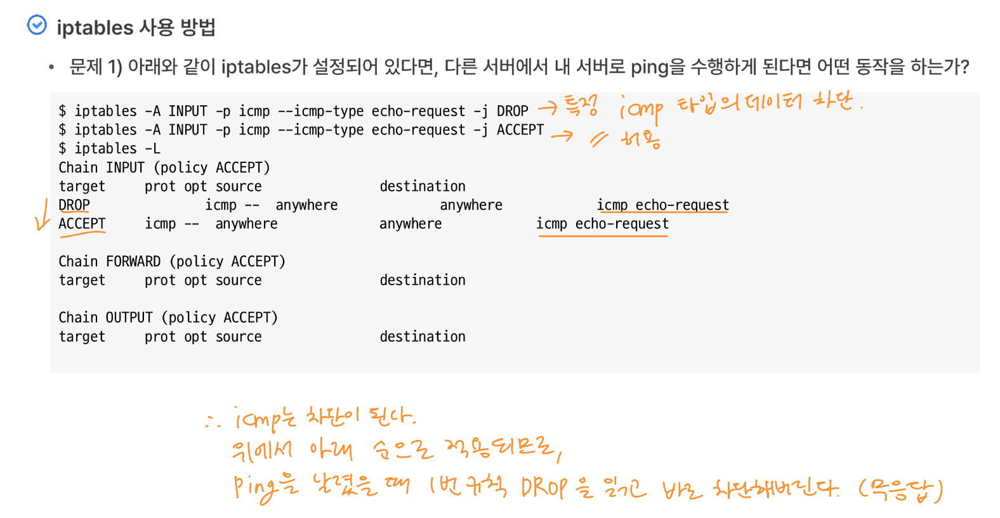

# [K-Shield 주니어 기초과정] 학습 Day12
# 12. 리눅스 접근통제 기법

> **작성일자**: 2026-11-05
> **학습 주제**: 리눅스 접근통제 기법
> **실습 환경**: VMware Workstation, Rocky Linux 10.x

---

## 1. 학습 목표 및 요약
* 리눅스 접근통제 기법에 대해 학습한다. 
* iptables를 통한 접근통제에 대해 학습한다.

--- 

## 2. 학습 내용 및 예제 문제 풀기

### 2-1. iptables

1. iptables : 리눅스의 패킷 필터링 도구로서, 방화벽 구성이나 NAT에 사용된다. 리눅스의 대표적인 강력한 자체 방화벽이다.

* 출발지 또는 목적지에 따른 프로토콜, IP주소, 포트에 따른 각각의 허용 및 차단 설정을 하여 접근통제를 할 수 있다.
* 패킷에 대한 동작은 위에서부터 차례대로 각 규칙에 대해 검사한다.
* 규칙과 일치하는 패킷에 대하여 타겟에 지정한 ACCEPT, DROP 등을 수행한다.
* 규칙이 일치하고 작업이 수행되면, 패킷은 규칙의 결과에 따라 처리하고 체인에서 추가 규칙을 무시한다.
* 패킷이 체인의 모든 규칙과 매치하지 않아 규칙의 바닥에 도달하면 정해진 기본정책(policy)이 수행된다.

<br>

* policy ACCEPT : 특정 사용자 외에도 접근 허용
* policy DROP : 특정 사용자 외에는 접근이 허용되지 않음. 기본적으로 policy DROP 상태로 두는 편이다.
* 일반적으로 기본 정책을 DROP으로 설정하고, ACCEPT 할 포트와 아이피 주소 등을 설정한다.

<br>

* iptables 사용법

```bash
$ iptables [-t Table] [Action] [Chain] [Match] [-j Target]
```

<br>

2. iptables 서비스 시작

```bash
$ service iptables start 또는 systemctl
# systemctl이 최신버전이다.
```

<br>

### 2-2. iptables 옵션

1. Table의 종류 : filter, nat, mangle, raw, security

<br>

2. Chain (filter 테이블에 미리 정의된 3가지 체인)
* INPUT : 호스트 컴퓨터를 향한 모든 패킷
* OUTPUT : 호스트 컴퓨터에서 발생하는 모든 패킷
* FORWARD : 호스트 컴퓨터가 목적지가 아닌 모든 패킷. 즉, 라우터로 사용되는 호스트 컴퓨터를 통과하는 패킷

3. Action
* A : 새로운 규칙 추가
* D : 규칙 삭제
* C : 패킷 테스트 수행
* R : 기존의 규칙을 새로운 규칙으로 변경
* I : 새로운 규칙을 삽입
* L : 현재 설정된 규칙 출력
* F : chain 으로부터 규칙을 모두 삭제
* Z : 모든 chain의 패킷과 카운터 값을 0으로 지정
* N : 새로운 Chain 생성
* X : Chain 삭제 (기본 체인들인 Input, Output, Forward, Prerouting, Postrouting은 x옵션으로도 삭제되지 않는다.)
* P : 기본정책 변경

<br>

4. Match : iptables에서 패킷을 처리할 떄 만족해야 하는 조건

* s : 출발지 아이피 주소나 네트워크와의 매칭
* d : 목적지 아이피 주소나 네트워크와의 매칭
* p : 특정 프로토콜과의 매칭
* i : 입력 인터페이스
* o : 출력 인터페이스
* state : 연결 상태와의 매칭
* string : 애플리케이션 계층 데이터 바이트 순서와의 매칭
* comment : 커널 메모리 내의 규칙과 연계되는 최대 256바이트 주석
* y : SYN 패킷을 비 허용함
* f : 두 번째 이후의 조각에 대해 규칙을 명시함 (데이터가 클 경우 쪼개어 전달하는데, 그 쪼갠 2번째 조각부터 규칙을 적용시킨다는 의미이다.)
* j : 규칙에 맞는 패킷을 어떻게 처리할 것인가를 명시
* m : 특정 모듈과의 매치

<br>

5. Target
* ACCEPT : 패킷을 받아들임
* DROP : 마치 패킷이 전송된 적이 없던 것처럼 패킷을 버림 (사용자에게 어떠한 경고 메시지도 보여주지 않은 채 패킷을 드롭)
* RETURN : 호출 체인 내에서 패킷 처리를 계속 수행

<br>

6. iptables 기본 정책 변경 : 규칙에 명시되지 않은 패킷에 대한 처리를 어떻게 할 것인지에 대한 기본정책을 수립

```bash
# 들어오는 것은 기본으로 모두 차단
$ iptables -P INPUT DROP
$ iptables -P FORWARD DROP
```

<br>

```bash
# 나가는 것에 대해서는 기본적으로 모두 허용
$ iptables -P OUTPUT ACCEPT
```

<br>

### 2-3. iptables 사용법

```bash
# 1. 현재 설정된 iptables 규칙 확인

$ iptables -L
```
<br>


```bash
# 2. 현재 설정된 iptables 규칙 저장

$ service iptables save 
# 또는
$ iptables-save > firewall.sh
# > 이 저장, < 이 불러오기
```

<br>


```bash
# 3. 저장된 iptables 불러오기

$ iptables-restore < firewall.sh
# > 이 저장, < 이 불러오기
```

<br>


```bash
# 4. 현재 설정된 iptables 규칙 초기화

$ iptables -F
```

<br>

```bash
# 5. 특정 아이피 차단

$ iptables -I INPUT -s xxx.xxx.xxx.xxx -j DROP
```

<br>

```bash
# 6. 특정 아이피 허용

$ iptables -I INPUT -s xxx.xxx.xxx.xxx -j ACCEPT
```

<br>

```bash
# 7. 특정 포트 차단

$ iptables -A INPUT -p tcp --dport xxxx -j DROP
# tcp : 포트가 있는 프로토콜. (크게 tcp와 udp가 있다.)
# --dport xxxx : 포트가 xxxx인 것들을 차단
```

<br>

```bash
# 8. 특정 아이피의 포트 허용

$ iptables -A INPUT -p tcp -s xxx.xxx.xxx.xxx --dport xxxx -j ACCEPT
# tcp 프로토콜로 xxx.xxx.xxx.xxx IP에서 들어오는 데이터 중, 포트가 xxxx인 것들은 허용한다
```

<br>

```bash
# 9. 적용된 규칙 삭제

$ iptables -D INPUT -p tcp -s xxx.xxx.xxx.xxx --dport xxxx -j ACCEPT
# 옵션을 A에서 D로 변경하면 됨.
```

<br>


### 2-4. iptables 사용법 예제 문제

1. 아래와 같이 iptables가 설정되어 있다면, 다른 버서에서 내 서버로 ping을 수행하게 된다면 어떤 동작을 하는가?



* icmp는 차단이 된다. iptables는 위에서부터 차례대로 규칙이 적용되므로, ping을 날렸을 때 1번 규칙인 DROP을 먼저 읽고 바로 차단을 해버린다. (무응답)

<br>

2. 출발지 아이피 주소가 192.168.0.111인 접속의 모든 접속 포트를 차단하는 규칙을 작성하시오.

```bash
$ iptables -A INPUT -s 192.168.0.111 -j DROP
```

<br>

3. INPUT Chain에 출발지 주소가 127.0.0.1인 icmp 패킷을 거부하는 규칙을 추가하시오.

```bash
$ iptables -A INPUT -p icmp -s 127.0.0.1 -j DROP
```

<br>

4. INPUT Chain에 목적지 포트가 http인 tcp 패킷을 받아들이는 규칙을 추가하시오.

```bash
$ iptables -A INPUT -p tcp --dport 80 -j ACCEPT
# http는 기본적으로 80번 포트를 가진다.
```

<br>

5. 위에 추가한 규칙의 포트를 8880으로 규칙 변경하시오.
```bash
$ iptables -R INPUT -p tcp --dport 8880 -j ACCEPT
```

<br>

### 2-5. 리눅스 방화벽 TCP Wrapper

1. TCP Wrapper : 리눅스의 서비스 별 IP 대역 또는 호스트명에 대한 접근통제 기법이다. (데몬의 일종이라고 볼 수 있다.)

* 임의의 호스트로부터 서비스 요청이 오면 실제 데몬을 구동하기 전에 접속을 허용한 시스템인지 여부를 확인하여 호스트명 및 서비스명을 로그에 기록한다.
* FTP, Telnet, SSH, xinetd 기반의 서비스 등에 대한 접근제어(ACL: Access Control List)가 가능하다.

<br>

* TCP Wrapper 설정파일
```bash
# 접속 허용 설정파일
$ /etc/hosts.allow

# 접속 차단 설정파일
$ /etc/hosts.deny
```

<br>

* TCP Wrapper 설정파일 사용방법
```bash
# [서비스명]: [호스트]
$ vi /etc/hosts.allow
# 또는
$ vi /etc/hosts.deny

# 예시 -> ALL : ALL
# 모든 서비스를 모든 아이피에 대해 허가 또는 거부
```