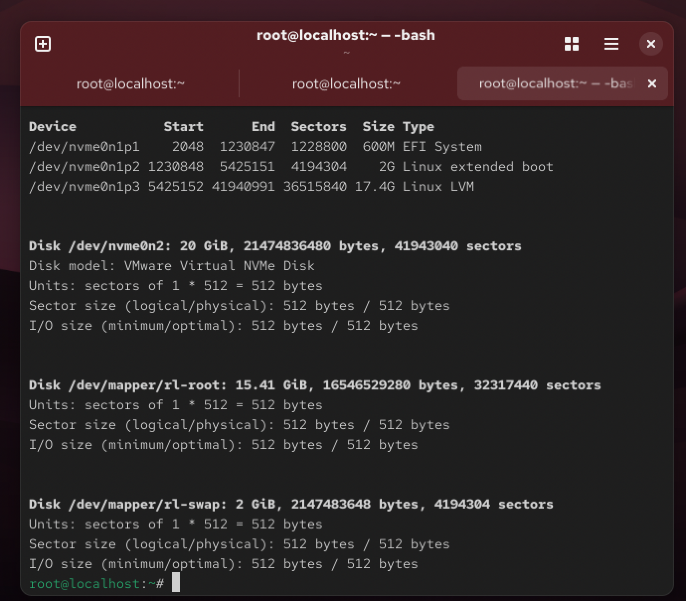
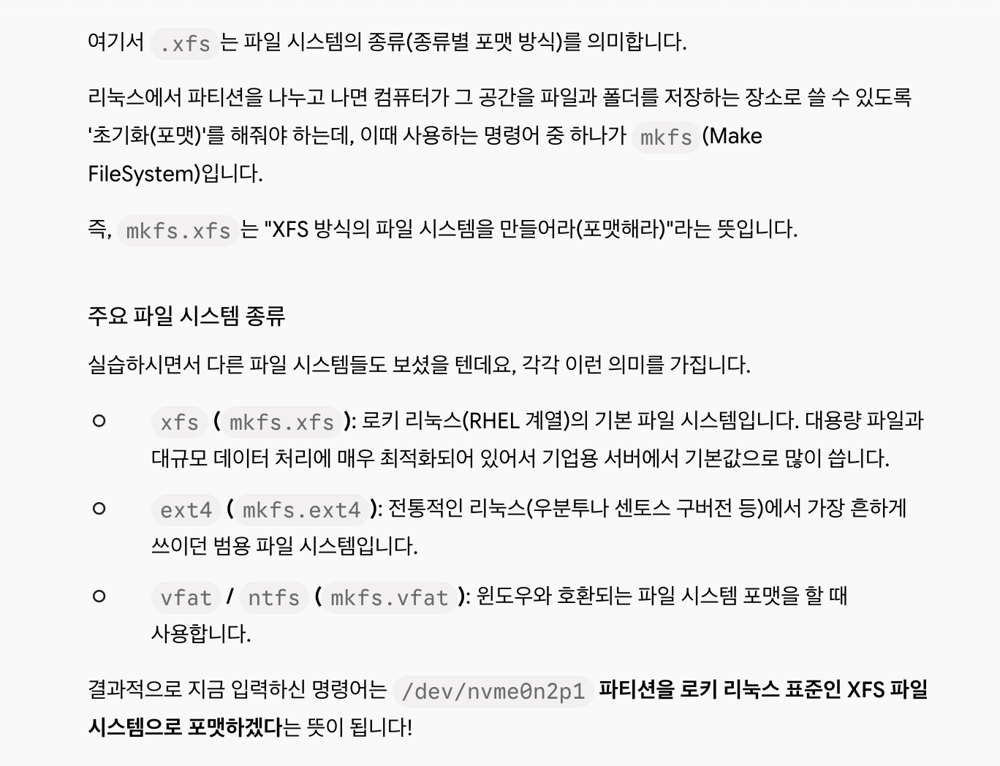

# [K-Shield 주니어 기초과정] 학습 Day6
# 06. 파일시스템 이해와 디스크 관리

> **작성일자**: 2026-10-06
> **학습 주제**: 파일시스템 이해와 디스크 관리
> **실습 환경**: VMware Workstation, Rocky Linux 10.x

---

## 1. 학습 목표 및 요약
* 디스크 관리와 파티션, 볼륨에 대해 학습한다. 
* 디스크를 장착하고 파티션을 구성하여 파일 시스템을 생성해 파티션을 마운트하는 것을 실습한다.

--- 

## 2. 학습 내용

### 2-1. 파일 시스템 이해
1. 파일 시스템 : 컴퓨팅에서 데이터 저장 및 검색 방법을 제어하는 체계이다.

<br>

2. 파티션 : 하나의 디스크를 여러 개의 파일 시스템으로 구성하는 것을 파티셔닝이라고 한다.
* 여러 개의 디스크를 하나의 파티션으로도 통합 가능하다.
* 운영체제의 경우 각 파티션을 별도의 디스크처럼 취급한다.

<br>

3. 볼륨 : 디스크 상의 논리적인 분할 단위이다. 섹터 또는 클러스터들이 모여 이루어진 큰 덩어리이다.

<br>

4. 파티션 VS 볼륨 : 파티션은 고정적이고 물리적인 개념이, 볼륨은 유동적이고 논리적인 개념이 강하다.

<br>

### 2-2. 리눅스 내 파일 시스템 이해

1. 리눅스 내 파티션의 종류
* 주 영역 파티션 ( Primary Patition )
* 확장 영역 파티션 ( Extended Partition )
* 논리 영역 파티션 ( Logical Partition )

<br>

2. 디스크 표현 방식
* 리눅스에서는 디스크 장치 디바이스도 파일 형태로 나타내며, 파일명은 특정 규칙에 구성된다.
* 디스크 장치는 /dev 디렉터리 내에 존재한다.

<br>

* 파일명 첫 번째 자리 : 하드 디스크의 종류를 의미한다. ( s, h )
* 파일명 두 번째 자리 : disk를 의미한다. ( d )
* 파일명 세 번째 자리 : 디스크의 개수를 의미한다. ( 알파벳 )
* 파일명 네 번째 자리 :  1 디스크당 파티션의 개수를 의미한다.

<br>

### 2-3. 파티션 구성 절차

0. 먼저 전원을 off 시킨다.
1. 디스크를 장착한다.
2. 추가된 디스크에 파티션을 구성한다. ($fdisk)
3. 파일 시스템을 생성한다. ($mkfs)
4. 새로운 마운트 포인트를 만들고 추가한 파티션을 마운트한다. ($mount)
* 마운트 : 저장 장치에 접근할 수 있는 경로를 디렉터리 구조에 편입하는 것.
5. 자동 연결을 위한 fstab을 등록한다.($ /etc/fstab, 등록을 안 해둘 경우 재부팅 시 구성해둔 파티션이 증발하므로 등록 필수)


<br>

### 2-3. 파티셔닝의 단점
1. 디스크 확장 시 디스크를 추가한 후 데이터 별도 이전 작업이 필요함.
2. 마운트한 폴더는 언마운트 작업이 필수이므로 번거로울 수 있음.


<br>

## 3. 리눅스 파티션 구성 실습


### 3-1. 가상머신에서 하드디스크 추가 후 파티션 구성
1. fdisk 명령을 통한 디스크 장착 여부 확인

```bash
$ fdisk -l
```

<br>

* nvme0n2 라는 두 번째 디스크가 추가된 것을 확인할 수 있음

<br>




<br>

2. fdisk 명령을 통한 파티션 설정, 옵션

```bash
$ fdisk /dev/nvme0n2    # 두 번째 디스크 선택
```


<br>

* 파티션 분할 확인 및 저장 후 종료


<br>

3. 파티션 적용 여부 확인

```bash
$ fdisk -l
```


* divice에 nvme0n2p1 확인


<br>


4. mkfs를 통한 파일 시스템 생성 (포멧), 디렉터리와 파티션 마운트, 마운트 여부 확인

```bash
$ mkfs.xfs /dev/nvme0n2p1   # 파일 시스템 생성
``` 
```bash
$ mount -t xfs /dev/nvme0n2p1 /home01 # 디렉터리와 파티션 마운트
``` 
```bash
$ df -h   # 마운트 여부 확인
``` 


<br>

4-1. 파일 시스템 포멧 방식의 종류



<br>

5. fstab 파일 수정을 통한 자동 마운트 등록 

```bash
$ /etc/fstab  # 파일 수정
``` 
```bash
$ /dev/nvme0n2p1    /home01 xfs defaults    0 0   # 해당 코드 추가
``` 

<br>

* /dev/nvme0n2p1 : 마운트할 장치
* /home01 : 마운트 포인트
* xfs : 파일 시스템 종류
* defaults : 마운트 옵션
* 0 : 덤프(Dump) 설정 - 백업 관련
* 0 : 파일 시스템 무결성 검사(fsck) 순서

<br>


<br>

6. 재부팅 후 디스크 설정 확인


