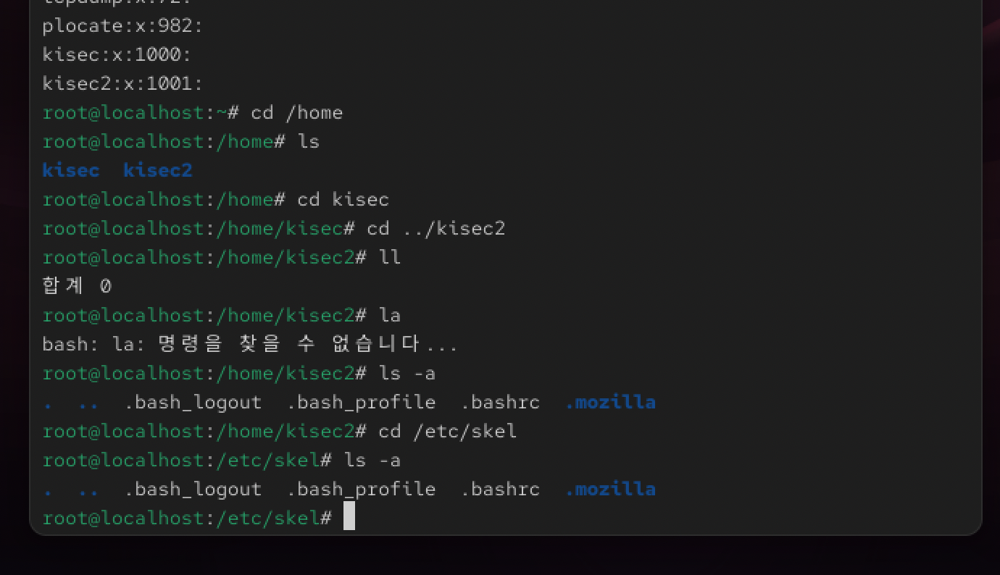
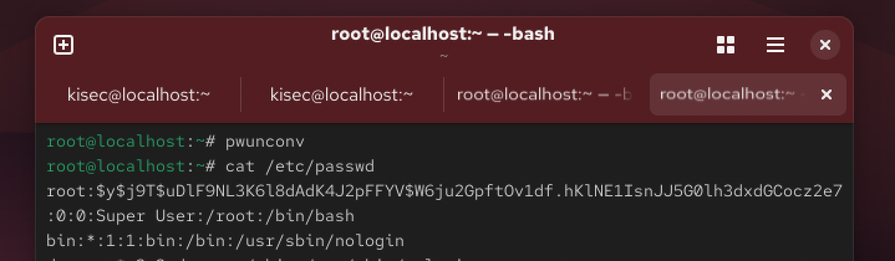

# [K-Shield 주니어 기초과정] 학습 Day7
# 07. 사용자 이해와 관리

> **작성일자**: 2026-10-13
> **학습 주제**: 사용자 이해와 관리
> **실습 환경**: VMware Workstation, Rocky Linux 10.x

---

## 1. 학습 목표 및 요약
* 계정과 사용자에 대해 이해한다.
* 사용자 계정을 생성하여 계정 관리 관련 파일 및 디렉토리를 설정하는 것을 실습한다.

--- 

## 2. 학습 내용

### 2-1. 계정의 이해
각 사용자의 권한은 일반 사용자 또는 root 사용자 중의 하나로 정의되며, 일반 사용자는 실행할 수 있는 퍼미션을 가진 파일에만 접근이 되고, root 사용자는 소유 여부에 관계 없이 모든 파일에 접근이 된다.

<br>

1. 리눅스에서 계정은 파일의 설정에 따라 관리

<br>

    < 리눅스 계정과 관련된 파일 >
    * /etc/passwd : 계정 이름과 관련된 정보
    * /etc/shadow : 패스워드와 관련된 정보
    * /etc/group : 계정그룹과 보조그룹 계정정보


<br>

2. 사용자 계정 생성

```bash
$ useradd kisec2
```
```bash
$ cat /etc/passwd | grep kisec
```


<br>

3. 패스워드 설정

```bash
$ passwd kisec2
```


<br>

4. 생성 계정 정보 확인


<br>

5. skel 디렉토리, shadow 파일, default 파일, login.defs 파일

* /etc/skel 디렉토리 : 해당 디렉토리 안에 들어 있는 파일 및 디렉토리를 계정 생성 시 홈 디렉토리에 제공

<br>

* /etc/shadow 파일 : 계정 정보 ( 계정명, 암호관련정보, 계정 만료일 등 )

<br>

* /etc/default/useadd 파일 : 계정 생성 시에 기본적으로 적용되는 설정이 들어있는 파일

<br>

* /etc/login.defs 파일 : 해당 파일에서 정의 되어지는 주요 값 ( 패스워드 정책 관련 설정, GID/UID의 최소/최대값, 기본 UMASK 값, 홈 디렉토리 생성 여부, 패스워드에 적용하는 암호화 알고리즘)





<br>

6. pwconv / pwunconv
* pwconv : /etc/passwd 파일의 두 번째 필드에 있는 암호화된 패스워드를 모두 x로 표시하고 /etc/shadow의 두 번째 필드에 저장하게 되며, root만 읽을 수 있도록 수정된다.
* pwunconv : etc/passwd 파일에서 해쉬화 된 암호로 볼 수 있다.



<br>

7. 계정 삭제

```bash
$ userdel
```


